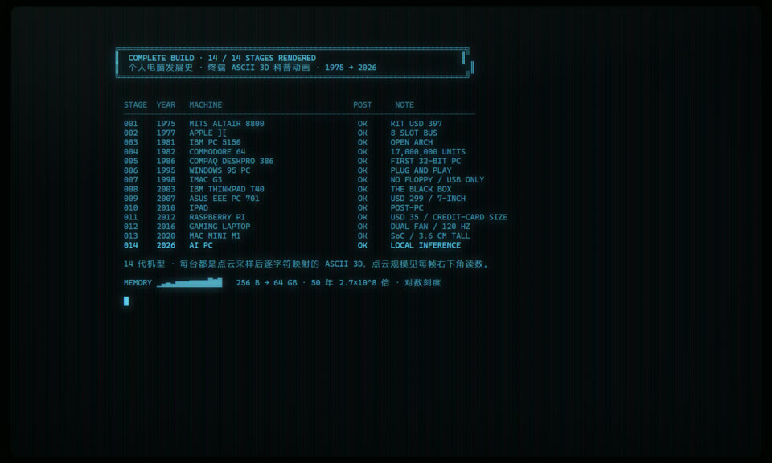

# 个人电脑发展史 · 终端 ASCII 3D 科普动画

**一个单文件、零依赖、可离线打开的终端风格科普短片。** 14 代个人电脑，每台都用
**纯 JS 点云渲染器**（**没有 three.js**，没有 CDN，没有构建步骤）实时采样、投影、着色，
再逐字符映射成 ASCII 3D —— 全程真 3D 旋转，不是贴图，也不是录屏。

![十四代机型示意：Apple ][ · Windows 95 PC · Mac mini M1 · AI PC](docs/img/overview.jpg)

▶ 成片下载：[**Releases**](../../releases/latest) · 1600×960 / 15fps / 4 分 18 秒 / 中文旁白 + 字幕已烧进画面

| 我想…… | 去哪儿 |
|---|---|
| **直接看效果** | 双击 [`index.html`](index.html)，4 分 18 秒自动播完 |
| **看单帧细节** | [`preview/`](preview) 里 15 张 1600×960 成片静帧 |
| **看完整成片** | [Releases](../../releases/latest) 下载 mp4（59 MB，不随仓库分发） |
| **用 AI 复刻一个** | [`docs/复刻提示词.md`](docs/复刻提示词.md) —— 分 8 轮的可粘贴提示词 + 参数表 + 踩坑表 |
| **看设计取舍** | [`docs/策划方案.md`](docs/策划方案.md) —— 分镜方案、被砍掉的方案及原因 |

## 下载成片

成片 **58 MB**，比整个代码仓库还大，而且每重渲一次就会在 git 历史里留一份清不掉的副本，
所以它不进仓库，放在 **[Releases](../../releases/latest)**：

| 文件 | 规格 |
|---|---|
| `个人电脑发展史.mp4` | 1600×960 · 15fps · 4 分 18 秒 · H.264 + AAC 44.1k 立体声 · 中文旁白 · 字幕已烧进画面 |
| `旁白字幕.srt` | 外挂字幕（仓库里也有一份：[`preview/旁白字幕.srt`](preview/旁白字幕.srt)） |

想自己重新出片就照 [`导出视频`](#导出视频) 那四步走，全程约 70 分钟，可以一字不改地复现。

## 项目结构

```
pc-history-terminal/
├── index.html                    全部代码：一个文件，106 KB，2048 行
├── README.md
├── LICENSE                       MIT
├── docs/
│   ├── 复刻提示词.md              用 AI 复刻本项目的分轮提示词
│   ├── 策划方案.md                分镜、机型选择、被砍方案
│   └── img/                       README 配图（从成片抽帧）
├── tools/
│   ├── render-video.mjs          逐帧逼出画面 + ffmpeg 合成（CDP，不录屏）
│   ├── shot.ps1                  无头 Chrome 截单帧，秒级出图
│   ├── voice.ps1                 edge-tts 旁白 + 侧链闪避 + loudnorm + SRT
│   ├── burn-subs.ps1             SRT → 带样式 ASS → libass 烧进画面
│   ├── narration.json            15 条旁白文案
│   └── timing.json               14 镜的 start/dur（由渲染脚本产出）
└── preview/
    ├── 00-结束卡.png + 01…14 机型.png   15 张 1600×960 静帧
    ├── 旁白字幕.srt               外挂字幕
    └── 个人电脑发展史.mp4         成片 —— 已 gitignore，走 Releases 分发
```

> 成片 58 MB，重渲一次历史里就会多一份且清不掉，所以 `.gitignore` 里写了 `*.mp4`。
> 上面的 `preview/个人电脑发展史.mp4` 是本地渲染产物，不入库。

## 打开

双击 `index.html`。整个动画就是这一个文件，没有任何外部依赖，也不需要服务器。

键盘：`SPACE` 暂停 · `←` `→` 切镜 · `R` 重播 · `C` 单色/真彩 · `M` 音效 · `F` 全屏。

调试参数：`?stage=N&freeze=T` 定格第 N 镜第 T 秒 · `?end=1` 直接到结束卡 · `?render=1` 进入逐帧录制模式。

想用 AI 复刻这个项目的话，看 [`docs/复刻提示词.md`](docs/复刻提示词.md) ——
里面是分 8 轮的可粘贴提示词、一张调好的参数表，和一张「症状 → 原因 → 做法」的踩坑表。

## 十四代机型（全部完成）

| # | 年份 | 机型 | 磷光配色 | POST 关键词 |
|---|------|------|----------|-------------|
| 01 | 1975 | MITS ALTAIR 8800 | 琥珀 | 256 BYTES / 25 TOGGLE / 36 LED / USD 397 |
| 02 | 1977 | APPLE ][ | 绿 | 6502 @ 1.023MHz / 4→48KB / 8 SLOT BUS |
| 03 | 1981 | IBM PC 5150 | 绿 | 8088 @ 4.77MHz / 16→256KB / PC-DOS 1.00 |
| 04 | 1982 | COMMODORE 64 | 青 | SID 6581 / VIC-II 320×200 / USD 595 |
| 05 | 1986 | COMPAQ DESKPRO 386 | 琥珀 | 80386DX @ 16MHz / 32 位内存总线 / USD 6499 |
| 06 | 1995 | WINDOWS 95 PC | 青绿 | Pentium 133 / PCI 即插即用 / Sound Blaster 16 |
| 07 | 1998 | iMAC G3 | 邦迪蓝 | G3 @ 233MHz / 只留 USB / 砍掉软驱 |
| 08 | 2003 | IBM THINKPAD T40 | 冷灰 | Pentium M 1.50GHz / 2.25 KG / 红点指点杆 |
| 09 | 2007 | ASUS EEE PC 701 | 中性白 | Celeron M 900 / 7 英寸 / USD 299 |
| 10 | 2010 | iPAD | 中性白 | A4 @ 1GHz / 多点触控 / 无键盘无文件系统 |
| 11 | 2012 | RASPBERRY PI | 绿 | ARM11 @ 700MHz / 26 针 GPIO / USD 35 |
| 12 | 2016 | GAMING LAPTOP | 紫 | i7-6700HQ / GTX 1060 / 120Hz / 双风扇四热管 |
| 13 | 2020 | MAC MINI M1 | 冷蓝 | M1 8 核 / 整机 3.6cm 高 / 1.20 KG |
| 14 | 2026 | AI PC | 紫 | NPU 45 TOPS / 本地 70B 模型 / 数据不出机器 |

每代机型名都以**大字铭牌**写在画面右下角（型号 + 中文名），年份与一句史实走左下角字幕。

**为什么最后不是「苹果十四连」**：一开始 2010 年后排了三台苹果（iPad / MacBook Air / M1 Air），
轮廓彼此重复，观众看到第八代就分不清了。现在 2010 年后的五台是
**玻璃板（iPad） → 裸电路板（树莓派） → 厚 RGB 游戏本 → 铝盒（Mac mini） → 深色 AI 本**，
苹果只占两台且造型毫不相干；全片苹果占比 4/14。

## 片尾

14 镜走完落到一张「构建报告」结束卡：14 行 `STAGE / YEAR / MACHINE / POST / NOTE` 全部 `OK`，
底部一条**对数刻度的内存火花线**（`▁▂▂▂▃▃▄▄▄▅▅▆▆▇█`）—— 从 256 B 长到 64 GB，
50 年涨了 2.7×10⁸ 倍。整片的增长曲线就压在这一行里。



## 分镜结构：B《POST 自检》

不是「编年旁白」，而是**一台机器开机自检的日志流**：每进入一代，左上角的
POST 面板就逐字符打印这一代的硬件参数（CPU / 内存 / 显示 / 存储 …），
每行打完后右侧亮起 `OK`；与此同时，3D 模型从下往上被「打印」出来。

## 画面构成（逻辑画布 1600×960）

```
row  0       顶栏  PC-HISTORY POST ═ STAGE nn/14 · 年份 ═ [进度条]
row  2–10    左上 POST 日志面板（黑底 HUD，压在 3D 之上）
row 10–41    ASCII 3D 渲染区（居中 120 格宽，高度按机型自适应）
row 41–42    年代轴：1975 … 2026 十四个点，当前代高亮
row 43       规格读数：POINT CLOUD nnn,nnn PTS · MESH nn BOXES · SS 3×3
row 44–46    字幕（左）：年份 · 机型 · 中文名 + 一句史实
row 44–46    铭牌（右）：型号大字 + 中文名
row 47       状态栏：快捷键 + 播放时间
```

### 点云渲染是怎么来的

做法参考 [HRuiCcc/RuiC-motion-reel](https://github.com/HRuiCcc/RuiC-motion-reel) 的 `engine/three.py` ——
那个项目的立场是「Deliberately not a triangle rasteriser」，把曲面密采样成点云再画。
这里把它从 Python/numpy 移植成 JS，并把「按深度排序散射」换成 **z-buffer**
（排 8 万个点太贵，深度测试是 O(n) 且零分配）。

1. 每台机型用 `mkBox()` / `mkGroup()` 拼出真实比例的盒子（宽 43cm × 深 45cm × 高 17cm …）。
2. `sampleBoxes()` 把每个盒子的 6 个面采样成点云。**+Z 面（正面）按 `FRONT_BIAS = 3.2` 加密** ——
   前面板的拨动开关、软驱缝全靠密度分辨。采样间距**双向**收敛到 `CLOUD_BUDGET = 78000` 点：
   不够就加密、超了就抽稀。必须双向 —— 树莓派只有 8.5cm 见方，单向「超了才缩」
   会让它只剩两千多个点，细节全丢。固定点数 = 每台机器在屏幕上一样细。
3. 每帧把机型旋转与视线基合成一个 3×3 矩阵。逐面做**背面剔除**，算一次相机空间光照：
   `lum = albedo × (AMBIENT + KEY_GAIN·max(0,dot(n,KEY)) + RIM_GAIN·rim³)`。
   - `KEY` 定义在**相机空间**，光源跟着镜头走，所以摆动到任何角度打光都成立。
   - **`albedo` 这一项不能省**：光照只看法线，近黑的凹槽和白色的开关同朝向会算出同一个亮度，
     面板细节全糊掉。（这正是 three.js 版能看见细节、点云版看不见的原因。）
   - `rim` 权重刻意压低（0.22）：它只该点亮轮廓，抬高了会把顶面和侧面一起抹平。
4. 每个点按 **2×2 splat** 写进 3×3 超采样深度缓冲（`SS = 3`，即每字符格 9 个采样）。
5. 归约后逐格：覆盖率 `Cbuf` 给出**抗锯齿剪影**（覆盖由满转空的那一圈就是外轮廓，
   点云白送的东西，不用拿 Sobel 去猜）；Sobel 只在有实体的邻居之间算内边缘；
   再叠一层基于深度的亮度衰减。
6. 映射到 10 档字符梯度 `" .:-=+*#%@"` 与 24 档磷光色阶。

画面右下角有一行规格读数，直接告诉你这一帧是多少个点采样出来的：
`◈ POINT CLOUD 78,837 PTS · MESH 74 BOXES · SS 3×3`

### 取景

`normalize()` 收集所有盒子几何的 8 个世界角点，`projExtent()` 在摆动范围内
求**真实投影轮廓**（不是包围盒 —— C64 + 1541 是 L 形，用包围盒算会让主机被缩小 27%），
据此反推相机距离与 3D 区高度。所以扁平的 Apple II 和高瘦的 IBM PC 都能填满画面。

### 一个让所有笔记本都变形的角度 bug

笔记本的屏幕是一个挂在**转轴**上的子坐标系：`mkGroup(g, 0, y, z, rx)`，
`mat3rx` 是行主序 `[1,0,0, 0,cos,-sin, 0,sin,cos]`。原来所有笔记本写的是 `rx = -1.83`，
看着像「-105°，屏幕向后倒」，实际算一下：

```
(0, 11.35, 0)  →  y' = 11.35 · cos(-1.83) = -2.94
                  z' = 11.35 · sin(-1.83) = -10.97
```

**`cos` 已经是负的** —— 屏幕越过了水平线，整个折到机身背后去平躺了。于是每台笔记本
都渲染成一枚「扁椭圆」，而不是一台立着屏幕的笔记本，这是「2008 年后没有辨识度」
最主要的成因。改成 `rx = -0.30`（向后倾 17°、屏幕仍然立着）之后，翻开的屏幕 +
键盘面立刻读得出来，2026 那台深色 AI 本也跟着好认了。**注意 `-1.83` 在
`Math.cos` 下不是「立着」，写角度前先算一次 cos 的符号。**

### CRT 质感

扫描线 / 荫罩 / 暗角 / 玻璃反光 / 随机闪动 五层叠加，外加一个半分辨率模糊辉光层
（`mix-blend-mode: screen`）。

**暗角要留余地给 HUD。** 原来 `#vig` 的终点是 `rgba(0,0,0,.82)`，而底部 4 行
（年代轴 / 点云读数 / 字幕 / 状态栏）正好铺在画面最下沿，整条被压掉 82% 黑，
几乎读不出来。现在椭圆拉到 `86% 96% at 50% 48%`、终点透明度 `.58`，
`#glass` 的内阴影从 `40px .5` 收到 `22px .28`，扫描线 opacity `.75 → .58` ——
暗角感还在，但边上不再压死。底部这四层文字本身也从 `.13/.30/.40` 提到 `.34/.70/.80`。

## 镜头语法与转场

第一版 14 个镜头共用一个摄影机函数（`sweep = sin·0.34 + sin·0.14`，只靠
`az/elev/spin` 三个数区分），换镜是一句 `resetStage(stage+1)` 硬切 —— 结果是
「14 张会动的图鉴」。第二轮改了四件事。

### 镜头语法 `shot`

`buildCam()` 里按 `s.shot` 在基准相机上叠偏移：

| `shot` | 做法 | 用在 |
|---|---|---|
| `hero` | 基准：±26° 扫描摆 | 大多数 |
| `dolly` | `distMul 1.26 → 0.76`（smoothstep）由远推近 | Altair 8800、AI PC |
| `crane` | 前 62% 的 `elevAdd 32° → 0`，高角度俯冲落到平视 | iMac G3、Mac mini |
| `orbit` | 摆动幅度 ×1.85（±26° → ±47°），看得见侧脸 | C64、游戏本 |

另有 `macro`（`distMul 0.72` + 竖向缓移）写好但没启用 —— 全机框住的图鉴感被打破，
试拍下来反而像「一块糊掉的板」，所以 ThinkPad 留在了 `hero`。

**插入镜「剖面」**：`s.burst = [t0, t1]`，窗口内 `amp = R·1.15·sin(πu)`，
点云沿径向炸开再合拢。给了 IBM PC 5150 —— 它的历史意义就是开放架构。
抖动系数 `jit` 单独调成 0.28（转场用 1.0），幅度也收小：抖动一大就不像
「拆开的零件」，而像「一团噪点」。

### 点云世代转场（`MORPH_T = 1.15s`）

每台机器的点云本来就被双向采样收敛到同一个预算，所以两边都是 ~8 万点、
同一个归一化空间 —— 但**点数并不逐点对应**，所以没做逐点插值（那需要
Morton 码重排两朵云），而是做「字符流」：

- 旧机：`alpha` 按 `1-a²` 溶解，`y -= amp·(0.55 + rnd·0.95)` 往下掉
- 新机：`amp` 按 `1-(1-b)³` 收拢，从画面下方升上来归位

两朵云**共用同一张深度缓冲**，所以前后遮挡是真的。实测过「径向爆散」版本，
四散成一整屏均匀噪点、读不出在变形；改成竖向漂移（像终端滚屏）之后，
观众看到的是「旧机器被字符冲走、新机器从字符里长出来」。

`RND` 是一张 `4 × 110000` 的确定性随机表（`Math.imul` 线性同余），
每点 4 个值：溶解阈值 + 三个抖动量。**不用 `Math.random()`** ——
录片模式下每帧必须可复现，否则同一帧渲染两次结果不同。

发散的 `splatCloud()` 签名：`(px, py, pz, segs, cam, alpha, morphAmp, radial, jit)`，
`renderMachine()` 现在只是「一台相机 + 一到两朵云 + 归约」。

### CRT 上电

只在片头 `S.st < 0.80`：一条亮线从屏幕中线 `1-(1-p)³` 炸开到整屏，
上下用黑矩形罩住还没开到的部分，边缘留一条发亮的扫描线。
`draw()` 的最外层，所以连 HUD 一起被「开」出来。

### 指数增长仪表

右上角常驻一条对数刻度条：`MEM_LO = 2.0`、`MEM_HI = 11.0`（log10，100 B → 100 GB），
每台机器的 `mem` 字段是字节数。线性轴上那根柱子永远是 0（256 B vs 64 GB 差 10⁸ 倍），
只有对数轴能让它变成一条几乎笔直的斜线 —— 观众自己会看出「这才刚刚开始」。

条里的空白格用 `·` 而不是 `░`：`░` 在 17px 下和 `█` 糊成一样粗，整条看起来是实心的。

## 交互

| 键 | 作用 |
|---|---|
| `SPACE` | 暂停 / 继续 |
| `←` `→` | 上一镜 / 下一镜 |
| `R` | 重播 |
| `C` | 单色（磷光）↔ 真彩（机器原本颜色） |
| `M` | 音效开关（见下「键击声」） |
| `F` | 全屏 |

## 键击声

片子一开场就在打字，所以**音效默认打开**：POST 面板每打一个字、底部字幕每打出
一个字，都会响一声键盘敲击。

一声「键击」由两层合成，只用一个噪声 tick 会像鼠标点击：

| 层 | 做法 | 听感 |
|---|---|---|
| 撞击瞬态 | 白噪声 → bandpass `2400Hz × j`（Q 1.4）→ highpass `1300Hz`，17ms 指数衰减 | 「哒」 |
| 低频 thock | triangle `210Hz × j` → 42ms 内滑到 `95Hz`，52ms 衰减 | 键帽砸到底的「咚」 |

`j = 0.86 + random*0.28`，每次随机微调音高与滤波中心，避免听起来像同一个采样反复播。
打字速度是 82 字/秒，逐字发声会连成一片嗡声，所以内部限速到 **~30 次/秒**，
且间隔带 `±34%` 抖动 —— 否则听起来像节拍器而不是手在敲。

**浏览器自动播放策略**要求先有一次用户交互，`AudioContext` 才会离开 `suspended`。
所以任何一次点击或按键都会顺手解锁（`audioUnlock()`）；还没解锁时顶栏右侧会显示
`♪ 键盘敲击声 · 点一下画面或按任意键开启`，状态栏的 `M 音效` 也会显示 `♪ 点击开启`。
解锁后还会叠一层 60/120Hz 的显像管底噪。

## 调试参数（URL query）

| 参数 | 作用 |
|---|---|
| `?stage=N` | 直接从第 N 镜开始（0 起） |
| `?freeze=T` | 把当前镜快进到第 T 秒并暂停（**不跨镜**） |
| `?seek=T` | 从第 1 镜开始快进 T 秒（正常跨镜） |
| `?end=1` | 直接跳到结束卡 |
| `?still=1` | 画 3 帧后停掉 rAF（配合无头截图，提速 20×） |
| `?zoom=Z&cx=X&cy=Y` | 放大逻辑画布的局部（`screen = Z*logical - c`） |
| `?preview=1` | 左上角叠加一张 480×180 的亮度×覆盖率灰度图（核对点云密度与遮挡） |
| `?audio=1` | 加载即解锁音频（配合 `--autoplay-policy=no-user-gesture-required` 做无头验证，状态栏会显示 `M 音效 ON`） |

## 导出视频

`preview/个人电脑发展史.mp4`（1600×960 / 15fps / **258.47 秒** / 56.7 MB / H.264 5.9 万码率 + AAC 44.1k 立体声 / **字幕烧进画面**）。
出片脚本是 `tools/render-video.mjs`，不是录屏 —— 它用 CDP 一帧一帧逼出画面再交给 ffmpeg，
所以 CSS 的扫描线、荫罩、暗角、玻璃反光全都原样保留。

```powershell
node tools/render-video.mjs --fps=15 --encode=1 --out=_video/film.mp4
```

**为什么不录屏**：录屏是实时截取，帧率被浏览器渲染速度绑死，而且窗口一动就掉帧。
这里改成页面不跑 `rAF`，由外部按 `1/fps` 的节拍调 `__renderFrame(fps)`，
页面内部再用 `1/60` 的细步长把时间线确定性推进 —— 同一帧永远出同一画面，可以随时中断续跑。

页面侧接口（`?render=1`）：`__TOTAL_SEC()` / `__TOTAL_FRAMES(fps)` / `__renderFrame(fps)` /
`__CLICK_COUNT()` / `__renderAudio()`。键击声不是在录片时录的：`keyClick()` 在录片模式下
只把 `[时间, 力度, 抖动, 播放速率]` 记进 `CLICKS`，最后用 `OfflineAudioContext` 一次性
把整条音轨合成出来，所以音画严格对齐、也不受实时调度抖动影响。

### 四个坑

**① 整屏 CSS 模糊贵得离谱。** `#bloom` 是一层 `filter: blur(7px)` + `mix-blend-mode: screen` 的
整屏辉光。实时看无所谓，但无头软件合成下一帧要 **900ms**，占了录片总耗时 70%。
改成录片模式下隐藏 `#bloom`，在 canvas 里先在 **400×240 的小图上模糊**（像素量 1/16）
再放大混合回来，等效半径约 8.8px，观感几乎一样，一帧降到几毫秒。

**② `advance()` 第一行会 early-return。** 它是 `if (S.ended || !S.playing) return;`，
而 `__renderFrame()` 里原本推进完就把 `S.playing` 置回 `false`，于是**只有第一帧真的推进，
之后每一帧都是同一画面** —— 表现为整片泛灰，其实是卡在开机闪白那 0.07 秒上。
录片时全程保持 `S.playing = true` 即可（顺便状态栏读数是 `▶ RUN`，比 `‖ PAUSE` 更适合成片）。

**③ `__renderAudio()` 在无头 Chrome 里可能永远出不来。** 它要在 `OfflineAudioContext`
里一次性合成几千次键击，实测卡了 **32 分钟**没产出（CPU 稳定 1.35 核，但就是不给结果）。
所以 `render-video.mjs` 加了 `--audio=0` 直接跳过这一趟：

```powershell
node tools/render-video.mjs --fps=15 --encode=1 --audio=0 --out=_t/video_new.mp4
```

键击声完全由 POST 面板的打字进度决定，**文案不改的话时间点一模一样**，
可以直接从上版成片里抽出来复用：

```powershell
ffmpeg -i "preview/个人电脑发展史.mp4" -vn -c:a pcm_s16le -ar 44100 -ac 2 _voice/bed.wav
ffmpeg -i _t/video_new.mp4 -i _voice/bed.wav -map 0:v -map 1:a -c:v copy -c:a aac -b:a 192k -shortest _voice/base.mp4
```

**④ 在 `.ps1` 里 `$var:` 会被当成作用域限定符。** `voice.ps1` 里写
`-vf "fade=t=out:st=$endHold:d=$endFade"`，PowerShell 把 `$endHold:d` 解析成
「驱动器 `endHold` 下的项 `d`」→ 空串 → ffmpeg 收到 `st==1`，报
`Unable to parse "st" option value "=1" as duration`。**变量后面紧跟冒号时必须写 `${endHold}`。**

另外 `--window-size=1600,960` 在 headless=new 下给的是外框尺寸，实际视口只有 1576×805，
必须补一次 `Emulation.setDeviceMetricsOverride` 才是真正的 1600×960。

## 旁白

成片带中文配音，15 条（14 代各一条 + 1 条收尾），男声 `zh-CN-YunyangNeural`、`--rate=-8%`。
文案在 `tools/narration.json`，逐条入点由 `tools/timing.json` 的 `stage.start + lead` 算出来，
所以**改文案只需改 narration.json 再重跑 `tools/voice.ps1`，不用重渲染画面**。

```powershell
Copy-Item "preview/个人电脑发展史.mp4" "_voice/base.mp4"   # ffmpeg 的 concat 吃不了中文绝对路径
powershell -ExecutionPolicy Bypass -File tools\voice.ps1
```

`tools/voice.ps1` 六步：逐条 TTS → 与键击轨做**侧链闪避**（`sidechaincompress`，旁白一响键击声自动压到 38%）→ 补一段 8 秒结束卡（淡出到黑）→ 视频流拷贝拼接 → `loudnorm` 到 -16 LUFS → 合流并内嵌 `mov_text` 软字幕（另有 `preview/旁白字幕.srt` 可直接外挂）。

完整顺序是 **`render-video.mjs` → `voice.ps1` → `burn-subs.ps1`**，三步各自读上一步的产物。
`preview/个人电脑发展史.mp4` 是最后一步的成品（字幕已经压进画面），所以重跑前要先从无字幕的版本起；
只改文案的话其实只要 `burn-subs.ps1` 这一道（91 秒），不必重跑 `voice.ps1`。

三件值得记的事：

- **edge-tts 7.2.8 全线 403**。报 `WSServerHandshakeError: 403 … speech.platform.bing.com`，
  是版本问题不是网络问题，`pip install --upgrade edge-tts`（→ 7.3.1）即可。
- **PowerShell 参数模式不做属性展开**。`& edge-tts --rate=$cfg.rate` 传进去的是字面量
  `--rate=@{voice=...;rate=...}.rate`，必须 `$rateArg = "--rate=" + $cfg.rate` 再作为独立参数传。
- **`loudnorm` 内部跑 192k**，不加一句 `aresample=44100` 的话 AAC 轨道会变成 96kHz。

`tools/voice.ps1` 和 `tools/shot.ps1` 一样**必须保持纯 ASCII**：无 BOM 的 `.ps1` 会被
Windows PowerShell 5.1 按 ANSI 解码，脚本里的中文会全部变问号。

### 字幕烧进画面

`tools/voice.ps1` 输出的是**软字幕**轨道，播放器不一定默认打开；所以最后再加一道
`tools/burn-subs.ps1`，把 `preview/旁白字幕.srt` 转成带样式的 ASS 后用 libass 压进画面。

```powershell
Copy-Item "preview/旁白字幕.srt" "_t/subs.srt"
Copy-Item "preview/个人电脑发展史.mp4" "_t/in.mp4"
powershell -ExecutionPolicy Bypass -File tools\burn-subs.ps1 -Srt _t/subs.srt -InMp4 _t/in.mp4 -OutMp4 _t/out.mp4
```

烧字幕这件事在这个片子里有三个非默认选择：

- **字幕带在时间轴上方，不在画面最底。** 画面的最下沿被自己的 HUD 占满了（时间轴 / 点云读数 /
  字幕文案 / 铭牌 / 状态栏），所以 `MarginV=148` 把字幕块底边放在 y≈812——
  压在时间轴上方那条空带里，正好不遮机器也不遮 HUD。
- **一条长旁白拆成多条单行字幕。** 按中文标点切成 ≤30 字，时长按字数比例分配。
  不拆的话 libass 会自动折成两行，第二行就压到时间轴上了。`——` 会被当成一个整体吃掉
  但**不作为断句点** —— 让字幕以破折号收尾读起来像没说完。
- **`ass` 滤镜要 ASCII 路径。** 生成的 `tools/subs.ass` 固定放在 ASCII 目录里，
  中文只从 `.srt` 内容里读，不进路径。

### 完整出片链路

从源码到带旁白带字幕的成片要跑四趟，前两趟是分钟级，第一趟是小时级：

```powershell
# 1) 逐帧渲染 + 编码            ~60 分钟  (3742 帧，0.85–0.93 s/帧)
node tools/render-video.mjs --fps=15 --encode=1 --audio=0 --out=_t/video_new.mp4

# 2) 补回音轨（复用上版的键击轨，见「坑 ③」）
ffmpeg -i _t/video_new.mp4 -i _voice/bed.wav -map 0:v -map 1:a -c:v copy -c:a aac -b:a 192k -shortest _voice/base.mp4

# 3) TTS + 闪避混音 + 片尾结束卡 + 响度归一化 + 生成 SRT   ~4 分钟
powershell -ExecutionPolicy Bypass -File tools\voice.ps1

# 4) 字幕烧进画面                                        ~90 秒
powershell -ExecutionPolicy Bypass -File tools\burn-subs.ps1
```

第 3 步要求 `_voice/base.mp4` 存在（`voice.ps1` 的默认入参）；它还会顺手
`node tools/render-video.mjs --endcard=_voice/endcard.png` 用页面自己画出结束卡再当尾帧。
第 4 步要求 `_t/subs.srt` 和 `_t/in.mp4` 存在（`_voice/voiceover.srt` → `_t/subs.srt`，
`_voice/film_final.mp4` → `_t/in.mp4`）。

**改文案不用重渲画面**：旁白和字幕都在第 3、4 步，只有改 `index.html` 里的
HUD / 机型 / 转场参数才需要回到第 1 步。

字体用 `Consolas`：拉丁字走等宽，中文自动回落到 `Microsoft YaHei`，
和页面里 `"Cascadia Mono","Consolas",…,"Microsoft YaHei",monospace` 是同一套。

## 截图

`tools/shot.ps1`（**必须保持纯 ASCII 编码**，否则 Windows PowerShell 5.1 会按 ANSI 解码中文路径）：

```powershell
& .\tools\shot.ps1 -Query "stage=0&freeze=14.5" -Out "_shots\f0.png" `
    -Budget 6000 -W 1600 -H 960 -TimeoutSec 60
```

脚本自己拉 Chrome headless（带独立 `--user-data-dir`）、轮询输出文件、
超时后用 `taskkill /PID <自己的 pid> /T /F` 只杀自己的进程树。

`preview/` 里是 14 代 + 结束卡共 15 张 1600×960 成片。

## 下一步

- 键击声是 Web Audio 实时合成的；旁白已加，但还没有配乐与转场音效
  （每个时代 1.5s 环境音 + 转场 whoosh 是最划算的一步）。
- 片尾「十四代群像」：14 朵点云同时出现在缓慢旋转的 3D 阵列里，
  代替现在这张文本表。**没做** —— 需要按比例抽稀成 14 × 6 千点的微型云，
  再单独写一条多机渲染路径，改动量比前四项加起来还大。
- 插入镜 D《对决》双机对撞（方案见 [`docs/策划方案.md`](docs/策划方案.md)）。C《剖面》已用
  `burst` 实现在 IBM PC 那一镜里。
- 旁白仍是第三人称纪录片腔。若改成第一人称（一台从 1975 活到 2026 的机器
  回忆一生），整片会立刻有主角 —— 只重跑配音，零渲染成本。

## 素材来源

- 点云渲染管线的思路来自 [HRuiCcc/RuiC-motion-reel](https://github.com/HRuiCcc/RuiC-motion-reel)
  —— 一个用代码生成动态图形成片的 Agent Skill，自研引擎里包含「真 3D 点云」渲染器。
  关键参考文件：`engine/three.py`、`references/three-d.md`、`references/gotchas.md`、`template/scenes.py`。
  本项目把它从 Python + numpy 移植成**不依赖任何库的纯 JS**，并把排序散射换成 z-buffer。
- [CCF · 我的计算机收藏之旅(5)：PC 时代（上）](https://www.ccf.org.cn/Computing_history/Updates/2020-06-17/706461.shtml)
- [Computing History · Introduction of IBM 5150](https://www.computinghistory.org.uk/det/6186/Introduction-of-IBM-5150-Personal-Computer/)
- [ASCII 3D 渲染的字符梯度流派参考：donut.c](https://github.com/Corg-Labs/donut)

## 许可

代码以 [MIT](LICENSE) 协议开源。机型名称、年份与规格属于公有史实；
片中未使用任何厂商商标素材，全部由点云重新建模。

成片（`preview/个人电脑发展史.mp4`）可以随意转发、剪辑、二创，注明出处即可。

